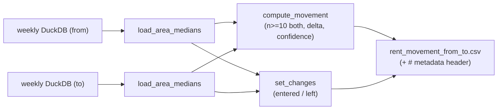

# Design — Week-over-Week Rent Movement

## Overview

A standalone module `lib/analysis/wow_movement.py` reads two or more weekly
DuckDB artifacts, computes a gated per-area median-rent movement, and writes a
CSV sidecar with a provenance header. It mirrors `lib/analysis/gold_indexes.py`:
pure functions for the logic, a thin `argparse` CLI, polars for compute, duckdb
for reads, `from __future__ import annotations`.

Shape B (chosen): a separate cross-week module. Each weekly artifact stays
self-contained — the module reads multiple files, it does not `ATTACH` one
artifact into another.

## Architecture

## Components and Interfaces

### `load_area_medians(path: str) -> tuple[pl.DataFrame, dict]`
Opens the DuckDB read-only, reads `gold_area_median` into a polars frame, and
reads `_meta` into a dict exposing at least `week` and `data_through`. Week label
falls back to the filename regex `rental_analytics_weekly_(\w+)\.duckdb` when
`_meta.week` is absent.

### `compute_movement(from_df, to_df) -> pl.DataFrame`
Inner-join on `area_name_en`. Filter to `n_from >= 10 AND n_to >= 10`. Emit
`area_name_en, n_from, n_to, median_from, median_to, delta_aed, delta_pct,
low_confidence`. `delta_pct = 100 * (median_to - median_from) / median_from`.
`low_confidence = (10 <= n_from <= 15) OR (10 <= n_to <= 15)`. No cross-area
aggregate is produced.

### `set_changes(from_df, to_df) -> pl.DataFrame`
Compute the n>=10 area sets for each week. Emit one row per area in the symmetric
difference with a `change` column: `entered` (in `to` set only) or `left` (in
`from` set only).

### `movement_for_series(paths: list[str]) -> list[dict]`
For each consecutive pair in `paths`, load both and return a result bundle
(movement frame, set-change frame, metadata). Enables a longer series with no
rewrite.

### `write_movement_csv(result, output_dir="output") -> str`
Write `rent_movement_<fromweek>_<toweek>.csv`. Prepend `#`-comment header lines:
`from_week`, `to_week`, `from_data_through`, `to_data_through`, `compared_areas`,
`entered`, `left`. Return the path.

### CLI (`python -m lib.analysis.wow_movement`)
- `--from <path> --to <path>` — the pair case.
- `--series p1 p2 p3 ...` — the ordered-list case (consecutive pairs).
Run through `uv`.

## Data Models

Movement row:

| column | type | meaning |
|---|---|---|
| area_name_en | str | area |
| n_from, n_to | int | contract counts (both >= 10) |
| median_from, median_to | float | AED/year medians |
| delta_aed | float | median_to − median_from |
| delta_pct | float | 100 × delta_aed / median_from |
| low_confidence | bool | either n in [10, 15] |

## Domain boundary (load-bearing)

Documented in the module docstring and the BI skills: this is a **two-point
measurement** of two already-gated medians, not a trend. No smoothing, no
projection, no claim beyond the two `data_through` dates, no averaging of area
movements into one number. This is what keeps the feature consistent with the
`rental-index-construction` rule against trends on thin data.

## Error Handling

- Missing view/file → raise with a clear message (fail-closed on a bad input).
- A week with zero qualifying areas → empty movement frame carrying the full
  schema (so a caller's concat/schema check does not break), header still written.
- `median_from == 0` guard: such rows cannot exist (gold medians are positive on
  comparable stock), but `delta_pct` computation handles/││asserts non-zero.

## Testing Strategy

- Unit tests on in-memory polars fixtures (no DuckDB needed for pure functions):
  n<10-either-side excluded; delta math; low_confidence band; set_changes labels
  entered/left (covers the rename/split case).
- Integration test reading the real W37/W38 artifacts when present (skip if
  absent): ~118 compared rows, every row `n_from >= 10 and n_to >= 10`.

## Integration

- `make movement` runs the pair case on the two most recent
  `output/rental_analytics_weekly_*.duckdb` files.
- Skill wiring: new anchors in `.kiro/steering/_reference-map.md`; a section +
  References bullet + contract edge in `rental-index-construction.md`; a one-line
  pointer in `rent-figure-trust.md`. References use the checker's exact format:
  `` - `path` — `symbol` — description ``.
- Shipping the CSV into the weekly release is deliberately out of scope here
  (a `release-and-ops` follow-up).
